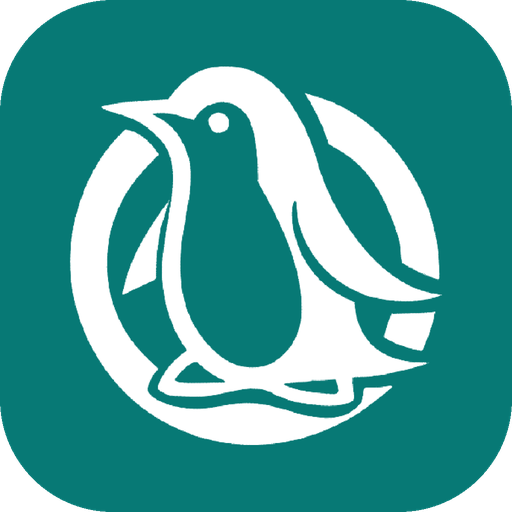

<p align="center">
  
</p>

<h1 align="center">Club de Software Libre @ UTEC</h1>

<p align="center">
  Web del CSL: eventos, proyectos y galería de la comunidad.
</p>

<p align="center">
  <a href="https://discord.gg/PU77KEXkzw">Discord</a> ·
  <a href="https://www.instagram.com/csl.utec/">Instagram</a> ·
  <a href="https://github.com/csl-club">GitHub</a> ·
  <a href="mailto:csl@utec.edu.pe">csl@utec.edu.pe</a>
</p>

---

En el CSL reunimos a estudiantes con ganas de aprender, crear y colaborar. Organizamos charlas, talleres y game jams, desarrollamos proyectos de código abierto y nos gusta Linux. Esta web también es software libre: cualquiera puede leerla, mejorarla y reutilizarla.

## Qué hay en la web

| Página       | Contenido                                                                 |
| ------------ | ------------------------------------------------------------------------- |
| `/`          | Presentación del club, eventos destacados, proyectos y manifiesto         |
| `/events`    | Historial de eventos en formato `git log`, con charlas, aliados y fotos   |
| `/projects`  | Proyectos de miembros (desde [awesome-utec](https://github.com/csl-club/awesome-utec)) y repos del club |
| `/gallery`   | Fotos de los eventos, agrupadas por álbum                                 |

## Desarrollo

Requiere [Node.js](https://nodejs.org) 22.12+ y [pnpm](https://pnpm.io).

```sh
pnpm install
pnpm dev      # http://localhost:4321
pnpm build    # genera el sitio estático en dist/
```

Hecho con [Astro](https://astro.build). Los eventos son archivos Markdown en `src/content/events/`, y los proyectos se leen de GitHub al generar el sitio.

## Contribuir

¿Encontraste un error, falta un evento o quieres mejorar algo? Lee la [guía de contribución](CONTRIBUTING.md): explica cómo preparar el entorno, agregar eventos y fotos, y enviar un pull request.

Para que tu proyecto aparezca en `/projects`, agrégalo a [awesome-utec](https://github.com/csl-club/awesome-utec).

## Licencia

El código se distribuye bajo la [GPL-3.0](LICENSE). Los textos del sitio, bajo [CC BY-SA 4.0](https://creativecommons.org/licenses/by-sa/4.0/deed.es).
